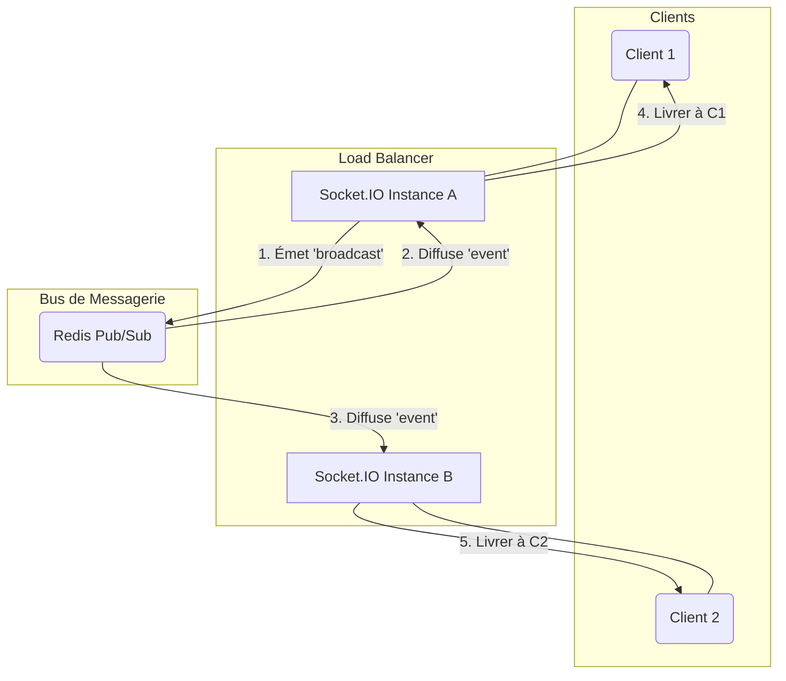

# Nicolas OSBORNE

# Applications Web Temps Réel - Examen Final

# Partie 1 - Questions théoriques

## Q1. Les technologies temps réel

> Comparez Polling long, Server-Sent Events (SSE) et WebSockets en indiquant :
>
> - Le principe de fonctionnement de chacun,
> - Le sens de communication (client → serveur / serveur → client / bidirectionnel),
> - Leurs avantages et limites,
> - Un cas d’usage typique pour chaque technologie.

- **Long Polling** :

  - `Principe de fonctionnement` : Le serveur maintient la connexion HTTP ouverte jusqu'à ce qu'il ait une donnée disponible, ou qu'il atteigne un timeout, sinon le client renvoie une requête.
  - `Sens de communication` : Client → Serveur → Client (Bidirectionnel). Le client envoie une requête, le serveur répond avec des données (ou lorsqu'il atteint le timeout), dès que le client reçoit la réponse il renvoit immédiatement une nouvelle requête.
  - `Avantages` : Simple à mettre en place côté client (HTTP) et moins de requêtes inutiles contrairement au polling classique. Peu de latence.
  - `Limites` : Surcharge de requêtes (nécessite de relancer la connexion après chaque réponse), limitations en termes de connexions concurrentes. Un peu plus complexe à mettre en place côté serveur pour gérer le maintien des connexions ouvertes.
  - `Cas d'usage typique` : Flux d'activité peu fréquent, comme par exemple une application de chat, envoi de notifications.

- **Server-Sent Events (SSE)** :

  - `Principe de fonctionnement` : Le serveur émet des événements vers le client via une seule connexion ouverte HTTP permanente et continue, et le client écoute les messages via des EventSource JavaScript.
  - `Sens de communication` : Serveur → Client (Unidirectionnel).
  - `Avantages` : Implémentation simple, reconnexion automatique.
  - `Limites` : Unidirectionnel (pas de communication du client vers le serveur).
  - `Cas d'usage typique` : Des applications ne nécessitant pas de trasmettre des données du client vers le serveur, comme par exemple des alertes, notification, flux d'informations ou mises à jour de dashboards en temps réel.

- **WebSocket** :
  - `Principe de fonctionnement` : Protocole permettant une interaction bidirectionnelle en temps réel, qui établit une connexion unique et persistante entre le client et le serveur (ou full-duplex).
  - `Sens de communication` : Client → Serveur → Client (Bidirectionnel). Le client envoie une requête HTTP avec un entête spécifique pour demander le changement de protocole. Si le serveur accepte (handshake), il change de protocole et envoit une réponse au client, ce qui ouvre la connexion TCP persistante, bidirectionnelle et asynchrone.
  - `Avantages` : Une latence considérablement réduite, le client et le serveur communiquent sans contrainte d'origine de message, repose sur une API JavaScript simple.
  - `Cas d'usage typique` : Des jeux multijoueurs, messageries instantannées.

## Q2. Les fondements de Socket.IO

> Expliquez le rôle et l’intérêt de ces trois mécanismes dans Socket.IO :
>
> - Namespaces
> - Rooms
> - Broadcast
>   Illustrez chacun avec un exemple concret.

- **Namespaces** : Les namespaces permettent de séparer une connexion WebSocket en différents canaux de communication de manière logique pour isoler les fonctionnalités sans avoir à ouvrir plusieurs connexions et ainsi organiser une application plus complexe. Un namespace commence par un "/".
  Par exemple : Un client se connecte au namespace `/admin` pour gérer le serveur et au namespace `/chat` pour discuter, tout en utilisant la même connexion.

- **Rooms** : Les rooms permettent de grouper des sockets pour adresser des messages à un ensemble de clients connectés, ainsi un socket peut rejoindre ou quitter des rooms. C'est un mécanisme clé pour gérer la distribution ciblée de messages.
  Par exemple : Dans une application de chat, chaque conversation est une room (qu'elle soit privée ou de groupe). Quand un utilisateur de la room envoie un message, il est envoyé uniquement aux sockets qui sont dans cette room.

- **Broadcast** : Le broadcast est la méthode utilisée pour envoyer un événement à tous les clients connectés sauf l'expéditeur.
  Par exemple : Un utilisateur envoie un message, et le serveur utilise la méthode `socket.broadcast.emit` pour envoyer ce message à tous les autres utilisateurs de la même room ou namespace.

## Q3. Scalabilité et Redis Pub/Sub

> Une application Socket.IO est déployée sur plusieurs instances derrière un load balancer.
>
> - Pourquoi les messages émis depuis une instance peuvent-ils ne pas atteindre tous les clients ?
> - Comment Redis Pub/Sub résout-il ce problème ?
> - Représentez (sous forme d’un schéma texte ou diagramme) une architecture typique utilisant Socket.IO + Redis Adapter.

Les messages émis depuis une instance Socket.IO peuvent ne pas atteindre tous les clients car par défaut, chaque instance gère ses propres connexions de manière isolée.

Redis Pub/Sub permet de résoudre ce problème en agissant comme un bus de messagerie central permettant la communication entre toutes les instances. Ainsi, chaque instance Socket.IO peut s'abonner (Subscribe) à un canal sur le serveur Redis. Lorsqu'une instance reçoit un message à broadcaster, au lieu de l'envoyer directement, elle le publie (Publish) sur le canal Redis. Toutes les instances abonnées au canal Redis reçoivent alors le message et le distribue uniquement aux clients qui sont censés le recevoir (même room ou namespace).

Voici un diagramme simple d'une architecture typique utilisant Socket.IO et Redis :

## Q4. Sécurité et Monitoring

> - Citez 3 risques de sécurité dans une application temps réel (Socket.IO, WebSocket).
> - Décrivez 3 bonnes pratiques pour limiter ces risques.
> - Indiquez 3 métriques ou indicateurs à surveiller pour assurer le bon fonctionnement d’une application temps réel.
> - Citez au moins un outil ou une technique simple de monitoring applicable (ex : console, Prometheus, métriques internes, logs).

- Risques de sécurité dans une application temps réel :

  - Attaques par DoS/DDoS : l'ouverture d'un grand nombre de connexions persistantes peut rapidement saturer le serveur et le rendre indisponible.
  - Attaques CSRF : à la différence des requêtes HTTP, les WebSockets ne suivent pas la politique same-origin, ainsi le serveur ne vérifie pas strictement les headers une fois la connexion ouverte.
  - Injections XSS : une absence de validation et de nettoyage des données reçues via le socket pourraient permettre d'injecter du code malveillant qui serait ensuite exécuté par tous les autres clients.

- Bonnes pratiques de sécurité :

  - Utiliser un chiffrement sécurisé pour la connexion (WSS).
  - Implémenter des limites de taux pour prévenir des abus et surcharges du serveur.
  - Vérifier l'origine lors du handshake initial pour s'assurer que la connexion provient d'une origine autorisée.

- Métriques à surveiller :

  - Nombre de connexions actives pour monitorer la charge du serveur (une croissance soudaine peut indiquer une attaque).
  - Latence des messages (une latence élevée peut indiquer une surcharge du serveur).
  - Taux de déconnexion (un taux élevé peut signaler des problèmes de réseau entre client et serveur).

- Outil de monitoring :
  - Prometheus : un outil de scraping et de stockage permettant de collecter les métriques de Socket.IO.
  - Grafana : permet de visualiser les données de Prometheus en temps réel sur des dashboards pour repérer facilement les anomalies.

## Q5. Bonnes Pratiques

> Donnez 5 bonnes pratiques pour assurer la fiabilité et la performance d’une application web temps réel (côté serveur et client).

- Gestion des déconnexions et reconnexions
- Mise en place d'un logging
- Tester régulièrement en conditions réelles (tests automatisés et manuels)
- Surveiller les métriques réseau pour anticiper des problèmes ou des attaques
- Isoler les logiques (à l'aide des namespaces, rooms)
